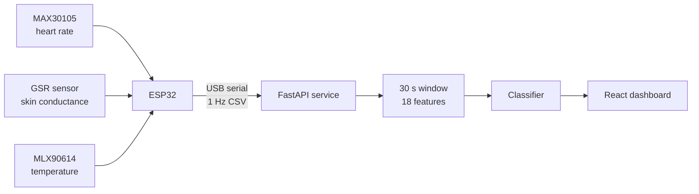

# Three-Sensor Wearable Stress Detection

Real-time baseline-versus-stress classification from an ESP32 wearable using exactly three sensors:

- **MAX30105** — optical heart rate (`bpm`, `avg_bpm`)
- **GSR sensor** — skin conductance (`gsr`)
- **MLX90614** — contactless temperature (`temp_c`)

The FastAPI service accepts samples at 1 Hz, builds a rolling 30-second window, extracts 18 features every 5 seconds, runs the configured classifier, smooths its probability, stores sessions in SQLite, and streams samples/features/predictions to the React dashboard.



## Sensor and feature contract

The live serial packet contains five values:

```text
timestamp,bpm,avg_bpm,gsr,temp_c
```

Example:

```text
125000,76,74,108.4,34.27
```

The model receives these 18 ordered features:

| Sensor | Features |
|---|---|
| MAX30105 heart rate (7) | `hr_mean`, `hr_std`, `hr_min`, `hr_max`, `hr_range`, `hr_slope`, `hr_pnn_proxy` |
| GSR skin conductance (8) | `gsr_mean`, `gsr_std`, `gsr_min`, `gsr_max`, `gsr_range`, `gsr_slope`, `gsr_auc`, `gsr_peaks` |
| MLX90614 temperature (3) | `temp_mean`, `temp_std`, `temp_slope` |

`src/stress_detection/service/features/schema.py` is the canonical ordering. Training and live inference both call the same feature pipeline.

## Hardware wiring

| Component | ESP32 connection | Purpose |
|---|---|---|
| MAX30105 | I²C SDA GPIO 21, SCL GPIO 22, 3.3 V | Heart rate |
| MLX90614 | Same I²C bus, SDA GPIO 21, SCL GPIO 22, 3.3 V | Temperature |
| GSR sensor | Analog output to GPIO 34, module-appropriate supply | Skin conductance |

MAX30105 normally uses address `0x57`; MLX90614 normally uses `0x5A`, so they can share one I²C bus. Confirm module voltage and pull-ups before powering the device.

Detailed setup and packet rules are in [docs/hardware_setup.md](docs/hardware_setup.md) and [docs/hardware_serial_format.md](docs/hardware_serial_format.md).

## Run locally

```bash
python3 -m venv .venv
source .venv/bin/activate
pip install -e .
python scripts/run_service.py
```

In another terminal:

```bash
cd frontend
npm install
npm run dev
```

The default input is synthetic but still passes through the real 18-feature pipeline and trained model. To use hardware, set `input.source: serial` and the device port in `config/service.yaml`.

## Rebuild data and models

The committed v4 artifacts were rebuilt for the 18-feature contract. After changing feature logic, rebuild everything in order:

```bash
.venv/bin/python scripts/build_interim.py
.venv/bin/python scripts/build_features.py
.venv/bin/python scripts/build_wesad_features.py
.venv/bin/python scripts/train_all_models.py --version v4
```

The WESAD adapter uses only its wrist BVP, EDA, and temperature signals so public-data training matches the three-sensor hardware contract.

## Inputs and APIs

The service supports `synthetic`, `csv_replay`, `serial`, and newline-delimited JSON `tcp` sources. All normalize to:

```json
{
  "timestamp_ms": 125000,
  "bpm": 76,
  "avg_bpm": 74,
  "gsr": 108.4,
  "temp_c": 34.27,
  "source_label": null
}
```

See [docs/api.md](docs/api.md) for REST and WebSocket details.

## Verification

```bash
.venv/bin/pytest
cd frontend && npm test && npm run build
```

This is a research prototype, not a medical device. Its output is not a diagnosis.
