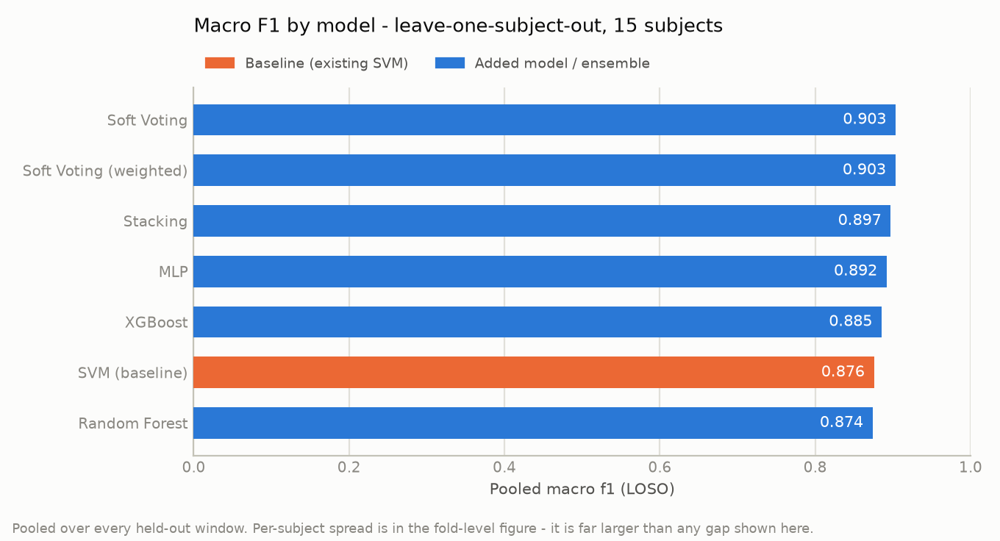
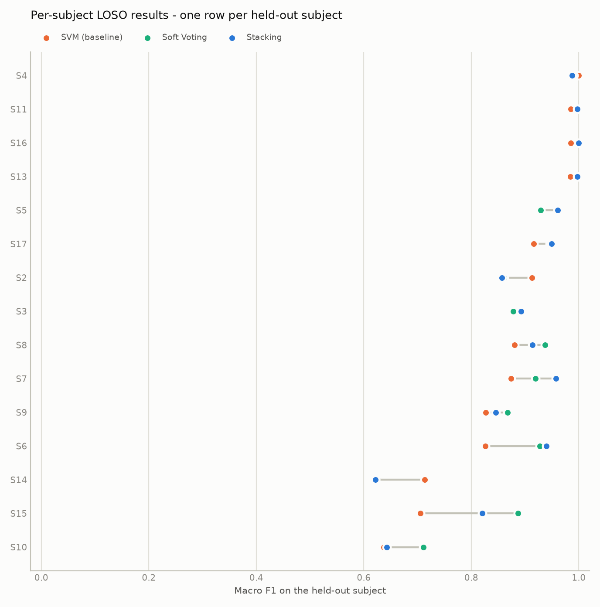
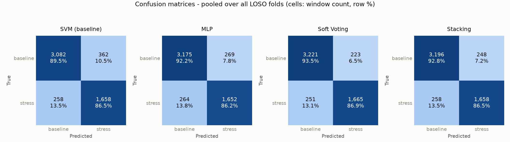
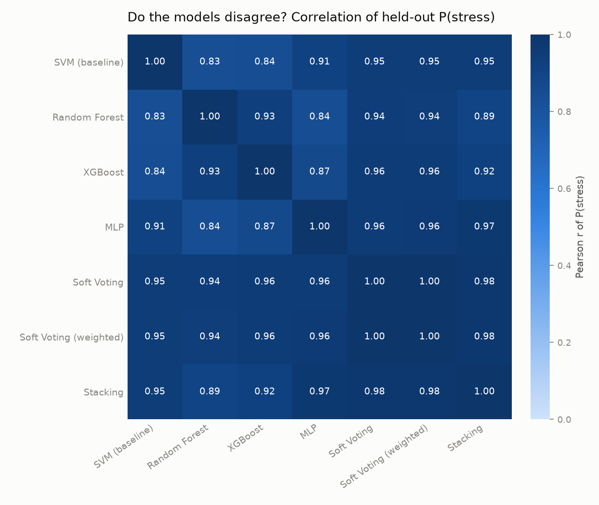

# Multi-Model Ensemble for Wearable Stress Detection

_Generated 2026-11-04T12:01:16+00:00 by `scripts/train_all_models.py` (version `v2`, seed `42`). Every number below comes from that run's held-out predictions._

## 1. Objective

The deployed system classified stress from an 18-feature window with a single RBF SVM. This report extends it to four base models (SVM, Random Forest, XGBoost, MLP) and two ensembles (soft voting and leakage-safe stacking), and compares all of them under one subject-independent protocol.

The question is **not** whether the ensemble wins. It is what the honest difference between these six options is on unseen subjects. The SVM remains the baseline and the deployment fallback.

## 2. Dataset

- **Source:** WESAD-only hardware-compatible dataset (15 subjects); 30 s windows at 5 s stride; BVP/heart rate, EDA/GSR and wrist temperature; features_wesad_v1.parquet
- **Windows:** 5,360 (30 s windows, 5 s stride)
- **Subjects:** 15
- **Features:** 18, in the canonical service order
- **Class balance:** baseline 3,444 / stress 1,916 (35.7% stress)

Windows per subject:

| Subject | Windows |
|---|---|
| S10 | 371 |
| S11 | 362 |
| S13 | 358 |
| S14 | 361 |
| S15 | 362 |
| S16 | 360 |
| S17 | 370 |
| S2 | 341 |
| S3 | 346 |
| S4 | 348 |
| S5 | 358 |
| S6 | 356 |
| S7 | 355 |
| S8 | 357 |
| S9 | 355 |

The 18-feature contract is unchanged: the same `service/features/schema.py` ordering is used for every model here and by the live `FeatureStreamer`, so train/serve parity is preserved.

## 3. Existing SVM baseline

`StandardScaler → SVC(kernel="rbf", probability=True)`, unchanged from Phase 1 and still the default fallback in `config/service.yaml`. Under the nested LOSO protocol described in §5 it scores:

- Accuracy **0.884**, macro-F1 **0.876**, stress-F1 **0.842**, ROC-AUC **0.956**
- Across subjects: macro-F1 0.873 ± 0.109

## 4. Model configurations

All four base models satisfy one interface - `fit` / `predict` / `predict_proba`, with `predict_proba(X)[:, 1] = P(stress)` and `0 = baseline, 1 = stress`. The ensemble and inference layers depend on nothing else.

| Model | Configuration | Notes |
|---|---|---|
| SVM (baseline) | `StandardScaler → SVC(rbf, probability=True)` | Unchanged Phase 1 pipeline. |
| Random Forest | `RandomForestClassifier` | No scaler - trees are invariant to monotone rescaling. |
| XGBoost | `XGBClassifier(binary:logistic, tree_method=hist)` | Optional dependency; lazily imported. |
| MLP | `StandardScaler → MLPClassifier(64, 32, 16)` | Early stopping on an internal 10% split of the training fold. |
| Soft Voting | weighted mean of the four `P(stress)` | Equal weights (0.25 each) is the primary variant. |
| Stacking | four `P(stress)` → `LogisticRegression` | Meta-features in fixed order `['svm', 'random_forest', 'xgboost', 'mlp']`. |

Deployed-artifact hyperparameters (selected by subject-grouped `GroupKFold` over the full dataset, seed `42`):

```
svm: {'svc__C': 1, 'svc__gamma': 'scale'}
random_forest: {'max_depth': None, 'max_features': 0.5, 'min_samples_leaf': 1, 'min_samples_split': 10, 'n_estimators': 200}
xgboost: {'colsample_bytree': 1.0, 'learning_rate': 0.05, 'max_depth': 3, 'min_child_weight': 5, 'n_estimators': 200, 'subsample': 0.8}
mlp: {'mlp__alpha': 0.0001, 'mlp__learning_rate_init': 0.003}
```

Validation-derived soft-voting weights (from grouped OOF ROC-AUC on the training data, the separately labelled experiment of §7): `svm=0.259`, `random_forest=0.240`, `xgboost=0.248`, `mlp=0.252`.

Deployed stacking meta-model coefficients: `svm=+1.967`, `random_forest=+1.833`, `xgboost=+0.895`, `mlp=+1.219`. A larger magnitude means the meta-model leans harder on that base model's probability.

## 5. LOSO evaluation protocol

The primary result is **nested leave-one-subject-out** over all 15 subjects (`LeaveOneGroupOut`, grouped by `subject_id`). No random window-level split is reported anywhere: windows overlap at a 5 s stride and come in long per-subject runs, so a random split puts near-duplicates on both sides and reads far too well.

For each held-out subject:

1. tune each base model on the training subjects only (inner `GroupKFold`, compact grid)
2. generate grouped out-of-fold `P(stress)` over the training subjects
3. derive soft-voting weights from those OOF probabilities
4. fit the `LogisticRegression` meta-model on those OOF probabilities
5. refit the base models on all training subjects
6. predict the held-out subject - once

The held-out subject takes no part in tuning, OOF generation, meta-model training, weight selection or threshold selection. The decision threshold stays at the application's existing `P(stress) >= 0.5`; it was not tuned.

Metrics reported per candidate: accuracy, macro-F1, per-class precision/recall/F1, confusion matrix, ROC-AUC and Brier score. Pooled values concatenate all folds so each window counts once; `± values are the spread across the 15 subjects`.

_Total nested-evaluation time: 3.0 minutes._

## 6. Leakage-safe stacking methodology

The invalid recipe, which this implementation does **not** use:

```text
train every base model on all data
        ↓
predict on that same training data
        ↓
train the meta-model on those predictions      ← optimistic, invalid
```

Instead, `generate_oof_probabilities()` builds the meta-features with `GroupKFold` over `subject_id`: every row's probability comes from a clone fitted on folds containing none of that row's subject. The disjointness is asserted at runtime per fold, and the function raises if any row would be left without an OOF prediction - so a future refactor cannot quietly reintroduce leakage.

```text
Subject k held out
    ↓
base models trained on the other subjects
    ↓
predict subject k          → OOF row block for k
    ↓ (for every subject)
OOF matrix [P_svm, P_rf, P_xgb, P_mlp]
    ↓
LogisticRegression meta-model
```

One approximation is documented rather than hidden: within a fold, the hyperparameters chosen in step 1 are reused by the step-2 OOF clones. That is selection information moving inside the training portion; it never touches the outer held-out subject.

## 7. Results

Pooled over all 15 held-out subjects:

| Model | Accuracy | Macro F1 | Stress F1 | ROC-AUC | Brier |
|---|---|---|---|---|---|
| Soft Voting | 0.912 | 0.903 | 0.875 | 0.964 | 0.068 |
| Soft Voting (weighted) | 0.911 | 0.903 | 0.875 | 0.965 | 0.068 |
| Stacking | 0.906 | 0.897 | 0.868 | 0.939 | 0.075 |
| MLP | 0.901 | 0.892 | 0.861 | 0.958 | 0.085 |
| XGBoost | 0.895 | 0.885 | 0.852 | 0.955 | 0.088 |
| SVM (baseline) | 0.884 | 0.876 | 0.842 | 0.956 | 0.087 |
| Random Forest | 0.886 | 0.874 | 0.835 | 0.945 | 0.087 |

Precision and recall per class:

| Model | Baseline P | Baseline R | Stress P | Stress R |
|---|---|---|---|---|
| Soft Voting | 0.928 | 0.935 | 0.882 | 0.869 |
| Soft Voting (weighted) | 0.928 | 0.935 | 0.881 | 0.869 |
| Stacking | 0.925 | 0.928 | 0.870 | 0.865 |
| MLP | 0.923 | 0.922 | 0.860 | 0.862 |
| XGBoost | 0.914 | 0.923 | 0.860 | 0.844 |
| SVM (baseline) | 0.923 | 0.895 | 0.821 | 0.865 |
| Random Forest | 0.897 | 0.928 | 0.863 | 0.809 |

Spread across subjects (mean ± SD of the per-fold metric):

| Model | Accuracy | Macro F1 | ROC-AUC |
|---|---|---|---|
| Soft Voting | 0.912 ± 0.085 | 0.898 ± 0.103 | 0.988 ± 0.014 |
| Soft Voting (weighted) | 0.912 ± 0.085 | 0.898 ± 0.103 | 0.988 ± 0.014 |
| Stacking | 0.906 ± 0.099 | 0.892 ± 0.116 | 0.985 ± 0.023 |
| MLP | 0.901 ± 0.104 | 0.889 ± 0.115 | 0.967 ± 0.054 |
| XGBoost | 0.895 ± 0.091 | 0.872 ± 0.143 | 0.987 ± 0.012 |
| SVM (baseline) | 0.885 ± 0.102 | 0.873 ± 0.109 | 0.970 ± 0.044 |
| Random Forest | 0.886 ± 0.086 | 0.861 ± 0.135 | 0.983 ± 0.019 |



### Per-subject (fold-level) results



The per-subject spread is far larger than any gap between models - the hardest subjects dominate every aggregate. Full per-fold numbers for every candidate are in `ensemble_fold_metrics_v2.csv`, and every held-out window's raw P(stress) from every candidate is in `ensemble_holdout_probabilities_v2.csv` - so any number in this report can be re-derived without re-running the sweep.

### Inference latency

| Model | Median (ms) | Mean (ms) | p95 (ms) | Max (ms) |
|---|---|---|---|---|
| SVM (baseline) | 0.16 | 0.17 | 0.19 | 0.26 |
| Random Forest | 13.51 | 13.23 | 13.73 | 37.04 |
| XGBoost | 0.11 | 0.11 | 0.14 | 0.21 |
| MLP | 0.14 | 0.28 | 0.43 | 18.75 |
| Soft Voting | 14.04 | 13.57 | 14.23 | 14.66 |
| Stacking | 14.09 | 13.65 | 14.30 | 14.49 |

Single-window `predict_proba`, which is what the live loop does. The slowest option costs 14.1 ms against a 5 s prediction cadence - 355x headroom, so model choice is not latency-bound here.

## 8. Confusion matrices



Shown for the SVM baseline, the best individual alternative (MLP), soft voting and stacking. Counts are pooled over all LOSO folds.

**SVM (baseline)**

| | Predicted baseline | Predicted stress |
|---|---|---|
| **True baseline** | 3,082 | 362 |
| **True stress** | 258 | 1,658 |

**MLP**

| | Predicted baseline | Predicted stress |
|---|---|---|
| **True baseline** | 3,175 | 269 |
| **True stress** | 264 | 1,652 |

**Soft Voting**

| | Predicted baseline | Predicted stress |
|---|---|---|
| **True baseline** | 3,221 | 223 |
| **True stress** | 251 | 1,665 |

**Stacking**

| | Predicted baseline | Predicted stress |
|---|---|---|
| **True baseline** | 3,196 | 248 |
| **True stress** | 258 | 1,658 |

## 9. Probability correlation



Pairwise Pearson correlation of the four base models' held-out `P(stress)` ranges from 0.83 to 0.93 (mean 0.87).

This is the number that bounds what any ensemble over these models could achieve: highly correlated members make the same mistakes, so averaging or stacking them has little independent signal to combine.

Raw `P(stress)` distributions by true class (§9 calibration check):

| Model | True class | Mean | SD | p05 | Median | p95 |
|---|---|---|---|---|---|---|
| SVM (baseline) | baseline | 0.115 | 0.255 | 0.000 | 0.002 | 0.866 |
| SVM (baseline) | stress | 0.852 | 0.286 | 0.063 | 0.997 | 1.000 |
| Random Forest | baseline | 0.149 | 0.194 | 0.000 | 0.047 | 0.531 |
| Random Forest | stress | 0.744 | 0.264 | 0.179 | 0.850 | 0.993 |
| XGBoost | baseline | 0.090 | 0.229 | 0.000 | 0.000 | 0.763 |
| XGBoost | stress | 0.834 | 0.329 | 0.012 | 0.997 | 1.000 |
| MLP | baseline | 0.083 | 0.247 | 0.000 | 0.000 | 0.915 |
| MLP | stress | 0.857 | 0.309 | 0.012 | 1.000 | 1.000 |
| Soft Voting | baseline | 0.109 | 0.192 | 0.000 | 0.021 | 0.571 |
| Soft Voting | stress | 0.822 | 0.264 | 0.134 | 0.950 | 0.998 |
| Soft Voting (weighted) | baseline | 0.109 | 0.193 | 0.000 | 0.020 | 0.573 |
| Soft Voting (weighted) | stress | 0.823 | 0.264 | 0.131 | 0.953 | 0.998 |
| Stacking | baseline | 0.110 | 0.201 | 0.018 | 0.034 | 0.710 |
| Stacking | stress | 0.797 | 0.274 | 0.051 | 0.893 | 0.983 |

Each model's own `predict_proba()` is used directly - no post-hoc calibration layer was added. Brier scores in §7 quantify how well those raw probabilities are calibrated; the table above shows whether they are on comparable scales, which is the precondition for averaging them at all.

## 10. Discussion

On pooled macro-F1 the ranking is: Soft Voting (0.903), Soft Voting (weighted) (0.903), Stacking (0.897), MLP (0.892), XGBoost (0.885), SVM (baseline) (0.876), Random Forest (0.874).

- **Random Forest** averages -0.012 macro-F1 below the SVM baseline per subject, better on 6 of 15 subjects and worse on 9; the per-subject difference is not significant (p=0.489), so this is within fold-to-fold noise.
- **XGBoost** averages -0.001 macro-F1 below the SVM baseline per subject, better on 8 of 15 subjects and worse on 7; the per-subject difference is not significant (p=0.934), so this is within fold-to-fold noise.
- **MLP** averages +0.015 macro-F1 above the SVM baseline per subject, better on 9 of 15 subjects and worse on 6; the per-subject difference is not significant (p=0.330), so this is within fold-to-fold noise.
- **Soft Voting** averages +0.025 macro-F1 above the SVM baseline per subject, better on 10 of 15 subjects and worse on 5; the per-subject difference is not significant (p=0.135), so this is within fold-to-fold noise.
- **Soft Voting (weighted)** averages +0.025 macro-F1 above the SVM baseline per subject, better on 10 of 15 subjects and worse on 5; the per-subject difference is not significant (p=0.135), so this is within fold-to-fold noise.
- **Stacking** averages +0.019 macro-F1 above the SVM baseline per subject, better on 11 of 15 subjects and worse on 3; the per-subject difference is not significant (p=0.109), so this is within fold-to-fold noise.

**Soft Voting ranks first on pooled macro-F1**, ahead of both the SVM baseline and the stacking ensemble.

Taken together with §9, the four base models agree closely (mean pairwise r 0.87), which caps how much combining them could change any single decision. But the per-subject test is the one that decides: at n=15 a difference of this size is not distinguishable from fold-to-fold variation, so the honest conclusion is that the ensembles are **comparable to** the SVM baseline on this dataset, not better than it. Collecting more subjects, not changing the model, is what would settle the question.

## 11. Limitations

- **Only 15 WESAD subjects.** Per-subject variance dominates every aggregate, and 15 paired folds give any statistical test little power.
- **Cross-device domain shift.** WESAD EDA is in µS; the project rig reports raw ADC counts. `StandardScaler` normalises each training set, but this is not formal domain adaptation.
- **Three-sensor alignment.** WESAD training uses only wrist BVP, EDA, and temperature to match the deployed hardware channels.
- **Hyperparameter approximation inside folds** (§6) - documented, bounded to the training portion.
- **No post-hoc probability calibration.** Raw `predict_proba()` outputs are averaged; §9 shows they are on broadly comparable scales, but tree and margin models are not calibrated the same way.
- **The decision threshold was not tuned.** It stays at the application's existing 0.5.
- **Per-user calibration is a heuristic feature shift**, not validated domain adaptation, and is unchanged by this work.

## 12. Conclusion

Four base models and two ensemble strategies were implemented and compared under one subject-independent protocol on 5,360 windows from 15 subjects, with stacking's meta-features generated out-of-fold so no held-out subject influenced any part of training.

Pooled macro-F1: SVM baseline 0.876, soft voting 0.903, stacking 0.897. Soft Voting ranks highest.

Artifacts written by this run:

- `data/models/svm_wesad_hardware_v2.joblib` - svm base model
- `data/models/rf_wesad_hardware_v2.joblib` - random_forest base model
- `data/models/xgb_wesad_hardware_v2.joblib` - xgboost base model
- `data/models/mlp_wesad_hardware_v2.joblib` - mlp base model
- `data/models/ensemble_soft_wesad_hardware_v2.joblib` - soft-voting ensemble (equal weights)
- `data/models/ensemble_stack_wesad_hardware_v2.joblib` - stacking ensemble (LogisticRegression meta-model)

**Deployed: Soft Voting** (`inference.model_type: soft_voting` in `config/service.yaml`).

Soft Voting scored +0.0279 macro-F1 higher than SVM. The improvement is smaller than the between-subject spread, so it should not be treated as proof that the ensemble generalises better to every real-world user.

The SVM remains available as the baseline and as the configured fallback, so the service keeps working whether or not the ensemble artifacts are present.
